# Olası proje önerileri (#33)

Bu rapor makine önerisidir. Taslak projeler admin'de **Projeler** altında yayınlanmamış olarak durur; sahibi her birini
açıp kontrol eder, başlığı düzeltir, eksik bilgileri (konum, yıl, ölçü, hikaye) kendisi girer ve ancak o zaman yayınlar.
Başlıklar yalnızca fotoğrafta görüneni anlatan çalışma başlıklarıdır; yıl yalnızca EXIF tarihinden yazılmıştır.

**17 küme, 68 fotoğraf** (20 aday kümeden gözle elenip ayıklandı; 568 fotoğrafın geri kalanı hiçbir kümeye girmedi).

## Yöntem

- Görsel benzerlik: open_clip `ViT-B-32/laion2b_s34b_b79k`, CPU (`scripts/clusters/embed.py` → `seed/clusters/embeddings.json`).
- Kümeleme (`src/lib/clusters/cluster.ts`): her kategori içinde ortalama bağlantılı (average-linkage) birleştirme;
  eşik `0.82` kosinüs. Aynı gün çekilmiş iki fotoğrafın benzerliğine `+0.1` eklenir;
  tarihleri `30` günden fazla ayrışan gruplar birleşmez. 3–24 fotoğraflık kümeler tutulur.
- Tarih: önce EXIF DateTimeOriginal (122 fotoğraf; saat bilgisi sıfır, yalnızca gün), yoksa dosya adındaki tarih
  (`IMG_YYYYMMDD_…`, `WhatsApp Image YYYY-MM-DD …`). WhatsApp adları iletim gününü taşır: 3+ kategoriye yayılan bir ad günü
  (ör. 2026-08-07, 69 fotoğraf, EXIF'leri 2022–2024) toplu aktarım sayılır ve yok sayılır.
- Gözden geçirme: aday kümelerin temas sayfalarına bakıldı; tek işe benzemeyenler atıldı, karışık kümelerden yalnızca
  açıkça aynı işe ait fotoğraflar tutuldu. Kararlar `seed/clusters/clusters.json` içinde (`candidate` = aday no).

## Notlar

- 3, 9, 10 ve 11 numaralı kümeler aynı WhatsApp günlerini (2021-06-08 / 2021-06-27) paylaşıyor; deck ve iroko kategorilerine
  bölünmüş tek bir iş olabilir. Kategoriler arası birleştirme yapılmadı, karar sahibinde.
- 15 (ofis) ve 8 (dış dolap) kümelerinde fotoğraflar aynı tarzda ama aynı yerden olduğu kesin değil.

## 1. Balkon deck'i ve metal korkuluk

- Kategori: Deck ve Zeminler (`deck-ve-zeminler`) · 4 fotoğraf · tarih: 2018-01-31 · anahtar `895d59681133`

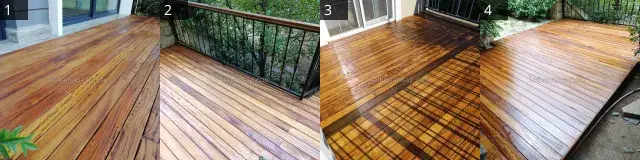

1. `cam-kapi-onu-ahsap-deck-zemin`
2. `bahce-kenari-ahsap-deck-demir-korkuluk`
3. `balkon-ahsap-deck-zemin`
4. `bahce-ahsap-deck-zemin-4`

## 2. Bahçede yükseltilmiş küçük deck platformu

- Kategori: Deck ve Zeminler (`deck-ve-zeminler`) · 3 fotoğraf · tarih: bilinmiyor · anahtar `3701b6dfcc3a`

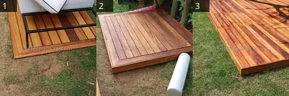

1. `bahce-oturma-grubu-ahsap-deck-platform`
2. `bahce-ahsap-deck-platformu-2`
3. `bahce-cim-uzeri-ahsap-deck-zemin`

## 3. Kapı önünde küçük bahçe deck'i

- Kategori: Deck ve Zeminler (`deck-ve-zeminler`) · 4 fotoğraf · tarih: 2021-06-08 – 2021-06-27 · anahtar `251cab6282a8`

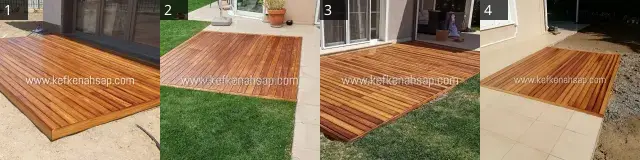

1. `surgulu-kapi-onu-ahsap-deck`
2. `bahce-cimenlik-ahsap-deck-zemin-2`
3. `bahce-ahsap-deck-zemin`
4. `bahce-terasi-ahsap-deck-kaplama`

## 4. Ahşap teras, korkuluk ve çatılı kamelya (2014)

- Kategori: Pergola ve Kamelyalar (`pergola-ve-kamelyalar`) · 3 fotoğraf · tarih: 2014-06-13 · anahtar `2e2333d9f45d`

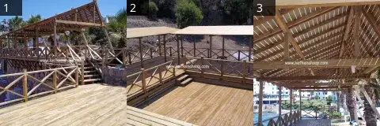

1. `ahsap-deck-teras-pergola-korkuluk`
2. `capraz-korkuluklu-ahsap-deck-ve-golgelik`
3. `deniz-kenari-kirma-catili-ahsap-kamelya`

## 5. Bahçe sınırında ahşap çit

- Kategori: Korkuluk ve Çit (`korkuluk-ve-cit`) · 6 fotoğraf · tarih: bilinmiyor · anahtar `2b2ce79b888c`

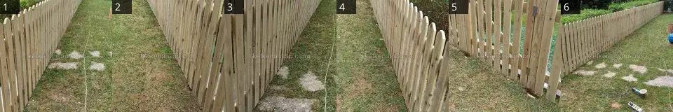

1. `bahce-sivri-uclu-ahsap-cit`
2. `bahce-ahsap-cit-yuvarlak-uclu`
3. `sivri-uclu-ahsap-bahce-citi`
4. `yuvarlak-basli-ahsap-bahce-citi`
5. `bahce-citi-ahsap-kapi`
6. `ahsap-bahce-citi-montaji`

## 6. Su kenarında ahşap yürüme yolu

- Kategori: Köprü ve İskele (`kopru-ve-iskele`) · 3 fotoğraf · tarih: 2006-06-16 · anahtar `dea60c169453`

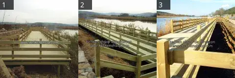

1. `gol-kenari-ahsap-yuruyus-koprusu`
2. `nehir-kenari-ahsap-yuruyus-yolu-korkuluk`
3. `su-kenari-ahsap-yuruyus-yolu-korkuluk`

## 7. Çapraz korkuluklu ahşap dış merdiven (2016)

- Kategori: Merdivenler (`merdivenler`) · 4 fotoğraf · tarih: 2016-08-24 · anahtar `5d3f916c5c27`

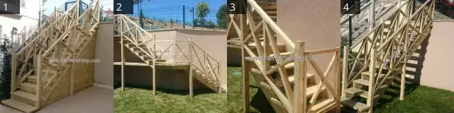

1. `capraz-korkuluklu-ahsap-dis-merdiven`
2. `bahce-ahsap-dis-merdiven-capraz-korkuluk`
3. `bahce-ahsap-merdiven-capraz-korkuluk-2`
4. `bahce-ahsap-merdiven-capraz-korkuluk-3`

## 8. Dış mekân ahşap dolapları

- Kategori: Kapı, Dolap ve Seperatör (`kapi-dolap-ve-seperator`) · 3 fotoğraf · tarih: 2016-10-08 · anahtar `80f8a9a6f478`

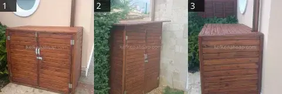

1. `dis-mekan-ahsap-dolap-cift-kapakli`
2. `bahce-ahsap-depo-dolabi-cift-kapakli`
3. `bahce-yatay-citali-ahsap-dis-mekan-dolabi`

## 9. Terasta pergola, çıtalı duvar ve dış mutfak

- Kategori: Iroko ve Teak (`ireko-teak`) · 8 fotoğraf · tarih: 2021-06-08 · anahtar `3dcd0f485042`

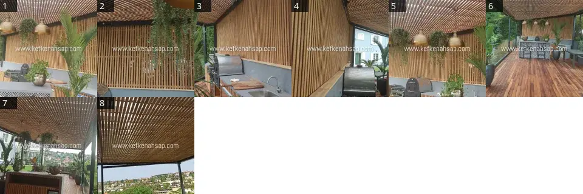

1. `bahce-mutfagi-citali-ahsap-tavan-duvar-kaplama`
2. `acik-mutfak-dikey-ahsap-cita-panel-tavan`
3. `ahsap-citali-acik-hava-mutfak`
4. `bahce-mutfagi-iroko-cita-duvar-tavan-kaplama`
5. `ahsap-cita-pergola-ve-duvar-kaplama`
6. `bahce-terasi-ahsap-deck-cita-tavan`
7. `iroko-deck-ve-ahsap-catili-teras-uygulamasi`
8. `ahsap-citali-pergola-tavani-teras`

## 10. Yarım daire ahşap oturma bankı

- Kategori: Iroko ve Teak (`ireko-teak`) · 3 fotoğraf · tarih: 2021-06-08 · anahtar `5468593ff723`

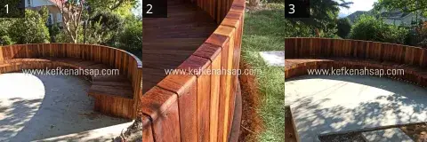

1. `bahce-kavisli-ahsap-oturma-banki`
2. `bahcede-yuvarlak-ahsap-deck-dikey-kaplama`
3. `bahce-yarim-daire-ahsap-oturma-banki`

## 11. Ahşap yemek masası ve bank

- Kategori: Iroko ve Teak (`ireko-teak`) · 4 fotoğraf · tarih: 2021-06-27 · anahtar `5b9bef6d04c7`

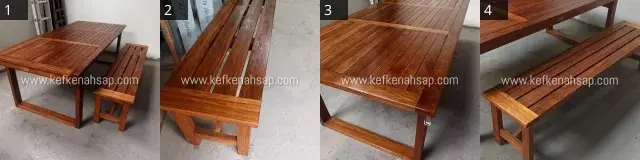

1. `citali-ahsap-masa-ve-bank-takimi`
2. `citali-ahsap-bank-atolye`
3. `citali-tabla-ahsap-masa`
4. `citali-ahsap-bahce-masasi-ve-bank-takimi`

## 12. Beyaz mutfak dolapları

- Kategori: Mobilya ve Cila (`mobilya-ve-cila`) · 5 fotoğraf · tarih: bilinmiyor · anahtar `61f9cc3852b5`

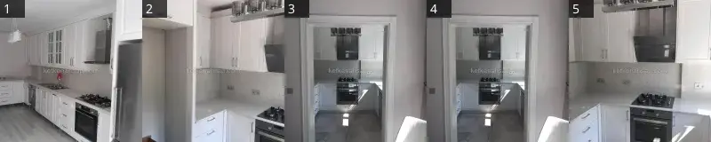

1. `beyaz-panelli-mutfak-dolabi`
2. `beyaz-cerceveli-kapakli-mutfak-dolabi`
3. `beyaz-boyali-cerceveli-mutfak-dolaplari`
4. `beyaz-boyali-kasa-u-tipi-mutfak-dolabi`
5. `beyaz-capli-kapakli-mutfak-dolaplari`

## 13. Ahşap tezgâhlı mutfak bar masası

- Kategori: Mobilya ve Cila (`mobilya-ve-cila`) · 3 fotoğraf · tarih: bilinmiyor · anahtar `1c41e979b94c`

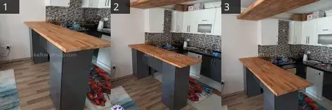

1. `mutfak-bar-tezgahi-masif-ahsap-gri-ayak`
2. `mutfak-masif-ahsap-bar-tezgahi-asma-raf`
3. `mutfak-ahsap-bar-tezgahi-asma-raf`

## 14. Kapaklı ahşap dolap

- Kategori: Mobilya ve Cila (`mobilya-ve-cila`) · 3 fotoğraf · tarih: bilinmiyor · anahtar `2d910786b640`

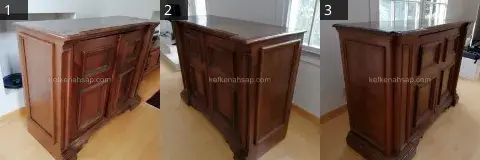

1. `kapakli-ahsap-konsol-dolabi-koyu-cila`
2. `cerceveli-kapakli-ahsap-dolap-cila`
3. `kasetli-kapakli-ahsap-dolap`

## 15. Ofis resepsiyon bankosu ve çalışma alanı

- Kategori: Mobilya ve Cila (`mobilya-ve-cila`) · 6 fotoğraf · tarih: bilinmiyor · anahtar `3e5f8b4e23af`

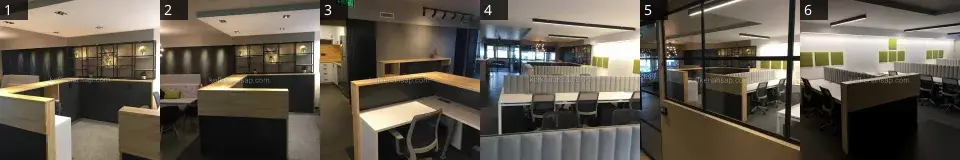

1. `ofis-tezgah-metal-cerceveli-raf`
2. `ofis-resepsiyon-bankosu-ahsap-citali-duvar`
3. `ofis-bankosu-ahsap-tezgah-mutfak-dolabi`
4. `acik-ofis-calisma-masalari-kumas-paravan`
5. `ofis-calisma-alani-ahsap-panel-cam-bolme`
6. `ofis-calisma-masasi-ahsap-mobilya`

## 16. Beyaz oymalı vitrin ve konsol

- Kategori: Mobilya ve Cila (`mobilya-ve-cila`) · 3 fotoğraf · tarih: bilinmiyor · anahtar `d9162a0eb096`

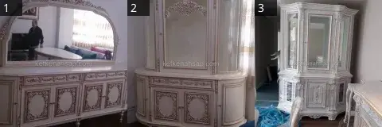

1. `krem-oymali-bufe-ayna-takimi`
2. `oymali-krem-vitrin-dolabi`
3. `klasik-oymali-vitrin-cila-yenileme`

## 17. Ahşap çıta kaplamalı ofis odası

- Kategori: Mobilya ve Cila (`mobilya-ve-cila`) · 3 fotoğraf · tarih: bilinmiyor · anahtar `c373d7f2da4f`

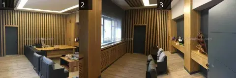

1. `ahsap-citali-duvar-kaplama-yonetici-ofisi`
2. `ofis-ahsap-duvar-kaplama-kalorifer-kapagi`
3. `ofis-ahsap-kaplama-citali-duvar-konsol-antrasit-kapi`
